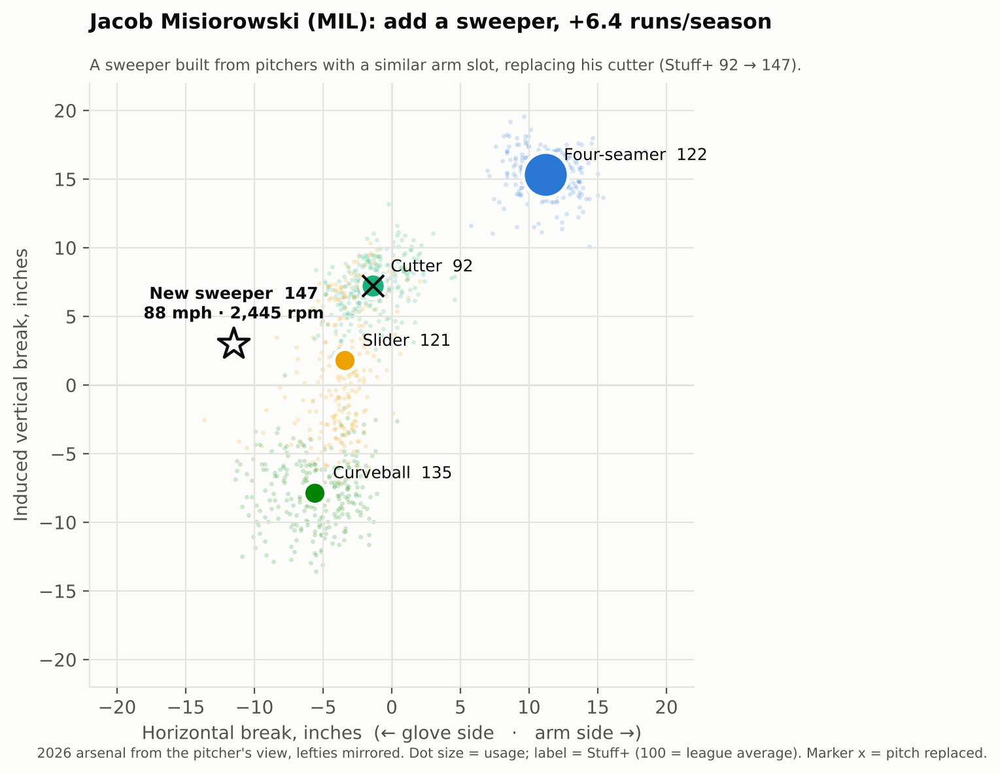
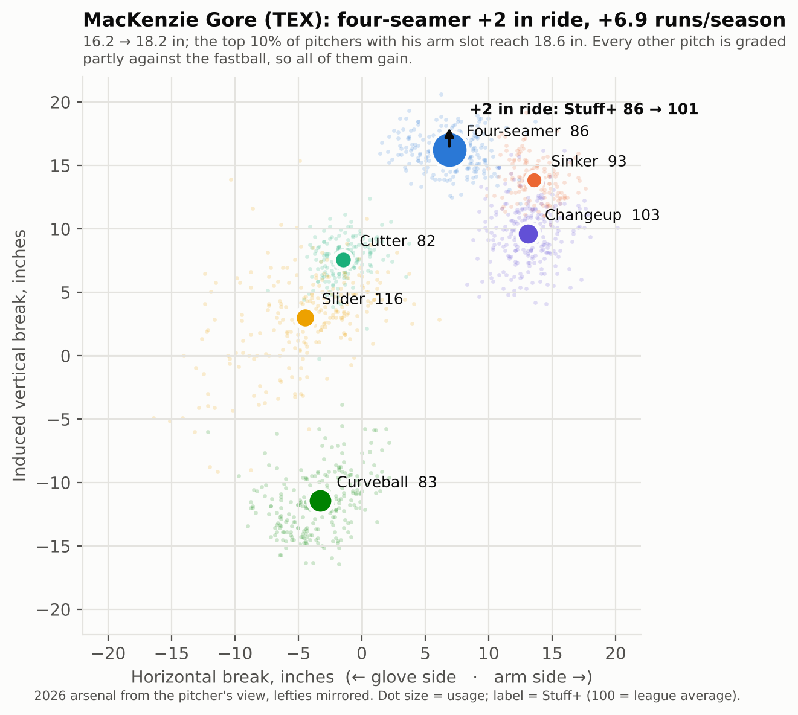
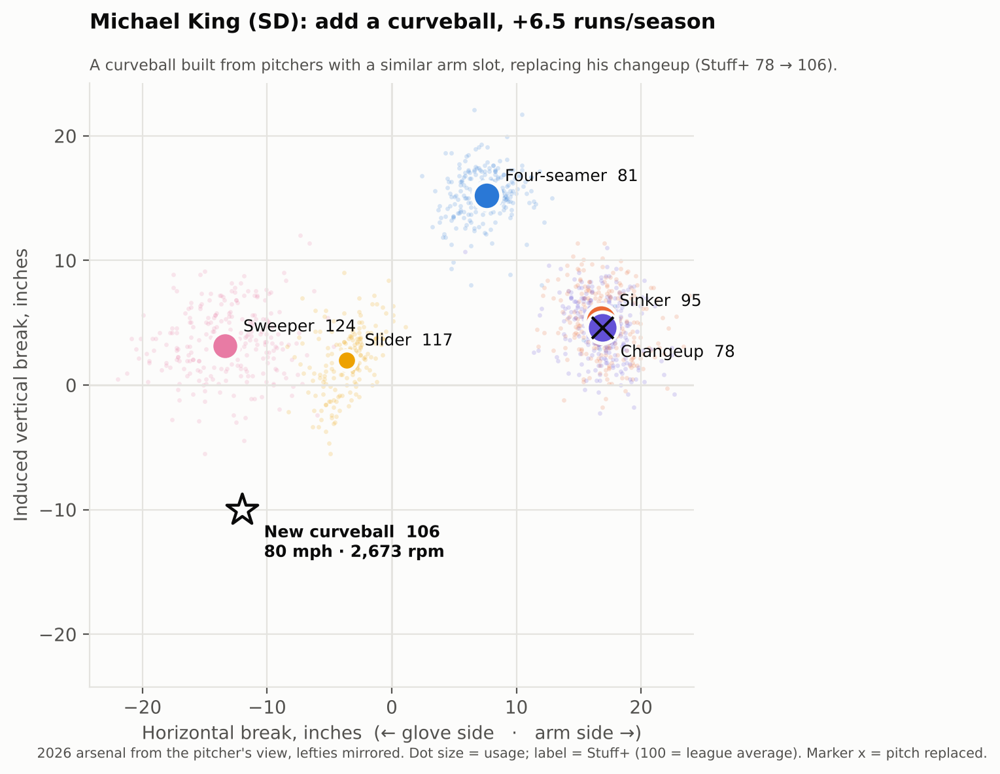
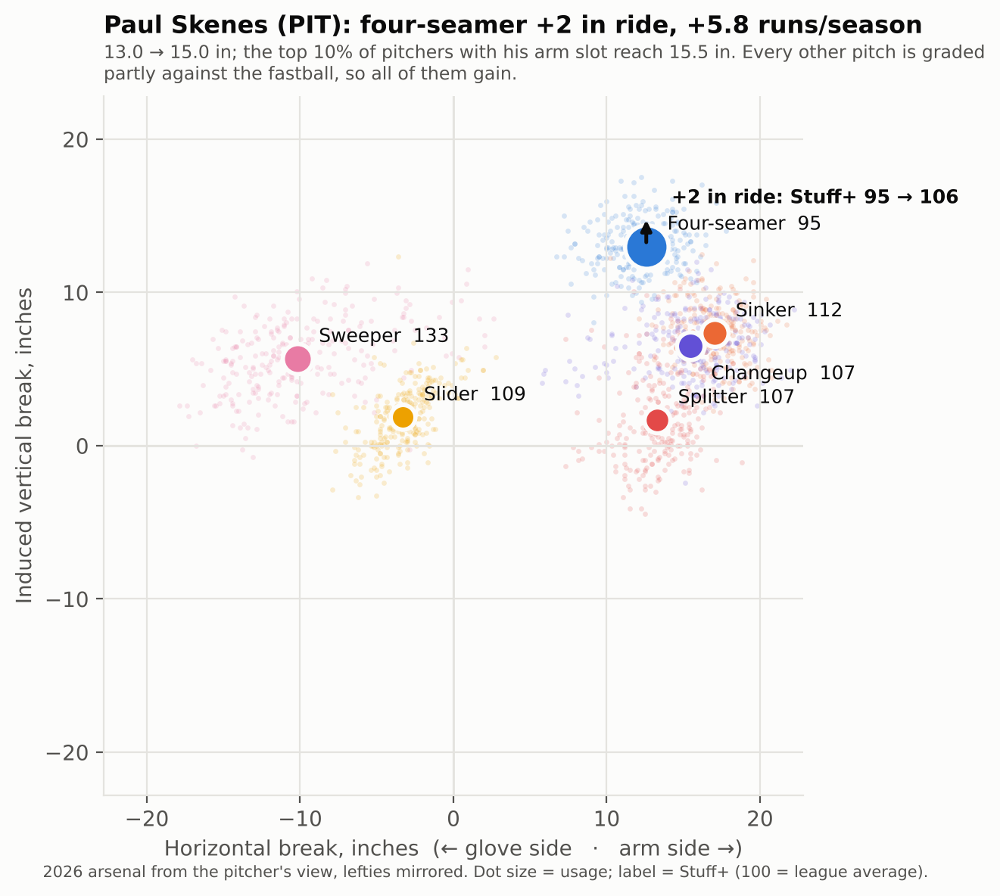
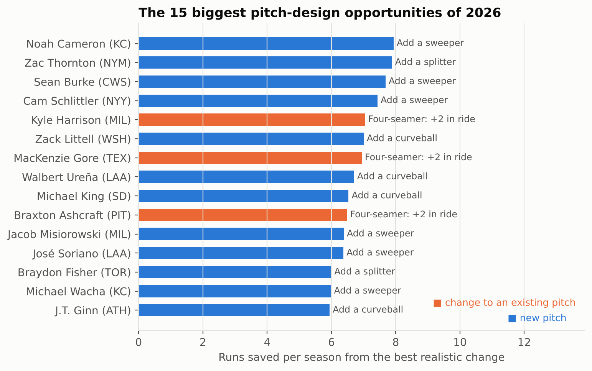
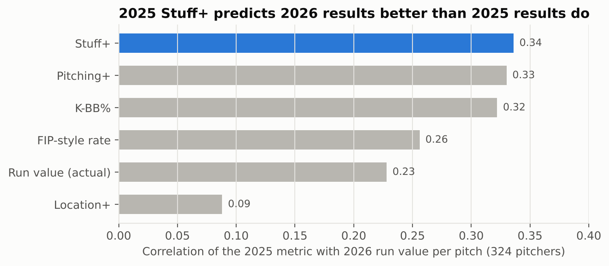
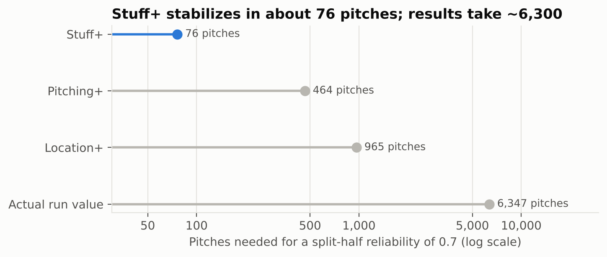
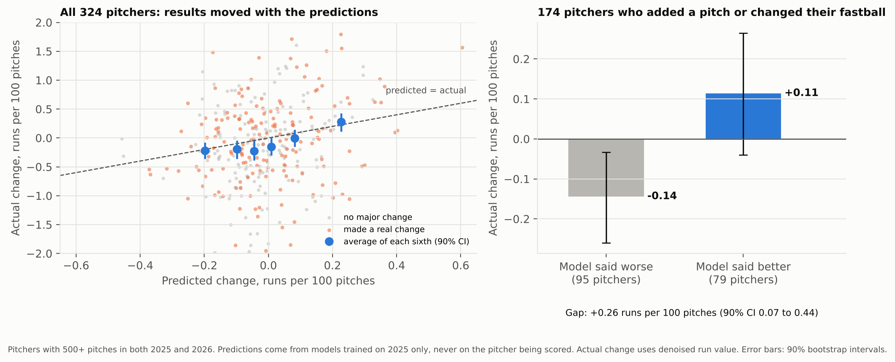

# Pitch Design Lab

Jordan Salter · M.S. Statistics, USC · October 2026

I built a Stuff+ model (along with Location+ and Pitching+) from every MLB pitch thrown in 2025 and 2026 regular seasons, of specific pitchers. Then I used it to answer a more practical question: for a specific pitcher, which change to his arsenal would help him the most?

Stuff+ leaderboards tell you who has good stuff, but they don't tell a pitcher what to work on. So for every pitcher with at least 800 pitches in 2026, I tested two kinds of changes:

1. Small adjustments to pitches he already throws, such as an extra two inches of ride on his fastball.
2. A new pitch, shaped like the ones thrown by pitchers with a similar arm slot and delivery.

Each change is valued in runs saved per season. I also tested whether this kind of advice holds up, using pitchers who actually changed their pitches between 2025 and 2026 ([below](#does-the-advice-hold-up)).

<table>
<tr>
<td width="50%"></td>
<td width="50%"></td>
</tr>
<tr>
<td><sub>Misiorowski's cutter grades 92, the weakest pitch in an otherwise elite arsenal. A sweeper in its place grades 147.</sub></td>
<td><sub>Two more inches of ride takes Gore's four-seamer from 86 to 101. The top 10% of pitchers with his arm slot already get there.</sub></td>
</tr>
</table>

**Reading the charts:** each pitch is plotted by its movement. Up means more rise, down means more drop, left is glove-side break and right is arm-side run. Bigger dots are pitches he throws more often, and the number next to each one is its Stuff+ (100 is league average). The star is the suggested pitch, and the X marks the pitch it would replace.

## Four pitchers

| Pitcher | What the model suggests | Stuff+ of that pitch | Runs/season |
|---|---|---|---|
| MacKenzie Gore (TEX, LHP) | Four-seamer: 2 more inches of ride (16.2 → 18.2 in) | 86 → 101 | +6.9 |
| Michael King (SD, RHP) | Add a curveball (80 mph, −10 in vertical, −12 in glove-side break) in place of his changeup | 78 → 106 | +6.5 |
| Jacob Misiorowski (MIL, RHP) | Add a sweeper (88 mph, −12 in glove-side break) in place of his cutter | 92 → 147 | +6.4 |
| Paul Skenes (PIT, RHP) | Four-seamer: 2 more inches of ride (13.0 → 15.0 in) | 95 → 106 | +5.8 |

All four come from the top 20 of the 333 pitchers I ran. I picked them because together they cover both kinds of change and a range of pitchers, from roughly league-average to elite. Misiorowski is the most interesting to me. By this model he already has one of the best arsenals in baseball, and it still finds a clear weak spot.

The model doesn't always find something. Mason Miller's best option is worth 0.03 runs, which makes sense for someone who throws 101 mph and has a slider grading 148.

Across all 333 pitchers, the best realistic change is worth a median of about 1.9 runs a season, and the largest is 7.9. For 207 of them, the best move is adjusting a pitch they already throw rather than adding a new one. The full results are in [`results/lab_opportunities.csv`](results/lab_opportunities.csv), with every option tested in [`lab_tweaks.csv`](results/lab_tweaks.csv) and [`lab_new_pitch.csv`](results/lab_new_pitch.csv).

<table>
<tr>
<td width="50%"></td>
<td width="50%"></td>
</tr>
<tr>
<td colspan="2"></td>
</tr>
</table>

## Does the model actually work?

Before trusting any recommendations, I wanted to know whether the grades meant anything. I ran two checks.

- **How fast it stabilizes.** I split each pitcher's season into odd and even games and checked how well the two halves agree. Stuff+ needs about 76 pitches to reach a reliability of 0.7. A pitcher's actual run value needs around 6,300.
- **Whether it predicts next season.** A pitcher's 2025 Stuff+ correlates with his 2026 run value at r = 0.34. His actual 2025 results only reach 0.23. A FIP-style rate reaches 0.26, and K-BB% reaches 0.32.

Location+ was the weak one, at r = 0.09 from one year to the next. Command seems to be mostly noise from season to season, which matches what other public research has found.

The 2026 leaderboard also looks right: Trey Yesavage, Chase Burns, Jacob Misiorowski, Roki Sasaki and Aaron Ashby are the top five among pitchers with 1,500+ pitches.

<table>
<tr>
<td width="50%"></td>
<td width="50%"></td>
</tr>
</table>

## Does the advice hold up?

Most pitch-design work stops at the recommendation. I wanted to check whether the model values changes correctly, and the 2025 to 2026 offseason gave me a test: 174 pitchers made a real change, either adding a new pitch (85) or changing their fastball's velocity or movement (129).

For every pitcher with 500+ pitches in both seasons (324), I compared two numbers:

- **Predicted change:** how much the model said his results should change, based only on how his pitches physically changed. These predictions come from models trained on 2025 data that never included him, so the model had no way of knowing how either of his seasons went.
- **Actual change:** how his run value per pitch actually changed.

When the model said a pitcher's changes would help, they generally did. Regressing actual change on predicted change gives a slope of 1.1 (90% CI 0.7 to 1.5) after controlling for his 2025 results. A slope of 1 would mean the model's run values are exactly the right size.

Among the 174 who made a real change, the ones the model expected to improve gained 0.11 runs per 100 pitches, and the ones it expected to get worse lost 0.14. That gap of 0.26 runs per 100 pitches (90% CI 0.07 to 0.44) works out to about 6.5 runs over a 2,500-pitch season, about the same size as the lab's top recommendations.

Roki Sasaki is the clearest example. He threw 2 mph harder with more ride in 2026 and added a firmer splitter. The model predicted the biggest improvement of anyone in the sample, and his actual improvement was the 7th biggest of the 324 (+1.6 runs per 100 pitches).



This isn't a randomized experiment: pitchers chose their own changes, and something like a healthier arm could drive both the physical change and the better results. Still, it's a real out-of-sample test, and the model passed it. Per-pitcher results are in [`results/backtest_pitchers.csv`](results/backtest_pitchers.csv).

## How I built it

1. **Features.** Velocity, spin, vertical and horizontal break, release point, extension and arm angle, plus how far each pitch is from the pitcher's own fastball in speed and movement. That last part matters: a 92-mph changeup and a 92-mph fastball can't be told apart without it. I mirrored left-handers so that arm side always points the same direction.
2. **Target.** Run value per pitch, adjusted for the count. For balls in play, I used the average outcome for that exit velocity and launch angle instead of what actually happened. That way the model isn't rewarded or punished for where the fielders were standing.
3. **Models.** I used gradient-boosted trees in scikit-learn. Each model is trained on one season and grades the other, so no pitch is ever graded by a model that saw it.
4. **The lab.**
   - **Tweaks.** For tweaks, I change one trait of a pitch and regrade the whole arsenal. A tweak only counts if at least 10% of pitchers with a similar arm angle and release height already throw it that way.
   - **New pitches.** For new pitches, I take the median shape of the same pitch from the 15 most similar pitchers and place it on this pitcher's fastball. It replaces his weakest secondary pitch at the same usage. Fastballs are never replaced.

[`METHODS.md`](METHODS.md) has more detail on each decision and the alternatives I considered.

## Limitations

- The model grades a pitch's movement and velocity, not whether a pitcher can command it, stay healthy throwing it, or learn it without hurting his other pitches. I'd treat the recommendations as ideas worth testing in a bullpen session, not answers.
- Sweepers grade very well here, as they do in most public Stuff+ models. Some of that is probably how sweepers are used (as chase pitches) rather than the pitch itself.
- With only two seasons of data, the next-season check and the backtest both rest on one pair of years (324 pitchers).
- The backtest is clearest with the denoised run value the model is trained on. With raw run value, which also includes fielding and luck on balls in play, the relationship is still positive but noisier (slope 0.7, 90% CI 0.0 to 1.3).

## Repo

```
src/              build_pitches → models → grades → lab → figures
results/          grades, validation, lab outputs, case studies, backtest
data/processed/   every 2025–26 pitch with its features and model scores
figures/          all charts
METHODS.md        modeling decisions in more detail
```

This project uses the pitch data from my [abs-challenge-analysis](https://github.com/jlsalter/abs-challenge-analysis) repo, which pulls 2025–26 Statcast data and lines up pitch locations across the two seasons. To reproduce it, run that pipeline first, then `bash run_all.sh path/to/abs-challenge-analysis/data/pitches.pkl.gz` (about 20 minutes).

Built with Python (pandas, NumPy, scikit-learn, matplotlib).

<sub>Data from Baseball Savant / MLB Advanced Media. Not affiliated with MLB.</sub>
